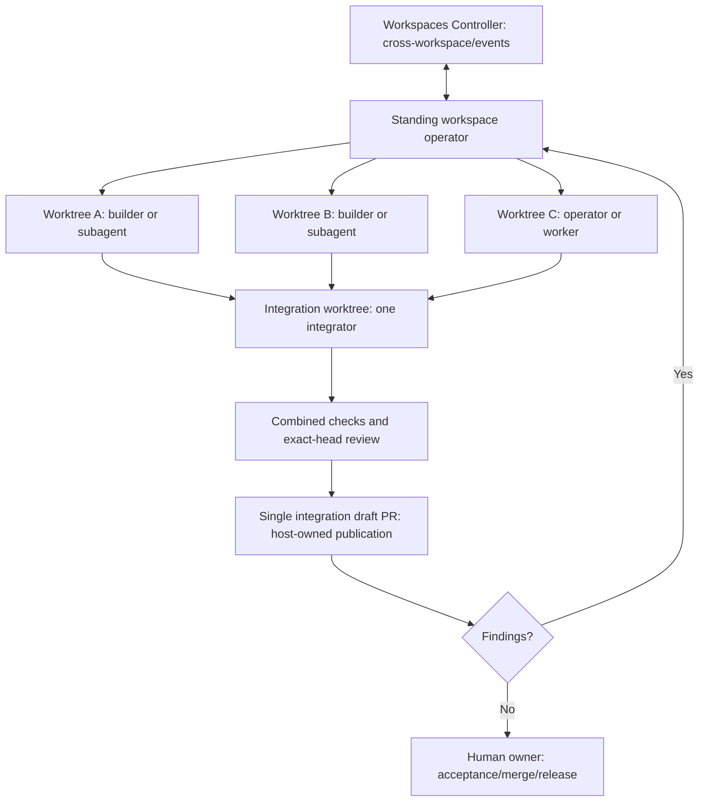

# Workspace-owned integration delivery

**Owner-directed coordination pattern (2026-11-23–24); proposed implementation, not a new installed skill, CLI, schema or permission grant.** The [session record](../records/2026-11-24-workspace-owned-integration-delivery.md) documents the motivating Agents PR #18–#22 episode and the owner's intended behavior. [Common workspace coordination](workspace-coordination.md) defines the foundational Git/worktree vocabulary; this page adds the **unit of acceptance and delivery**. The environment's rules take precedence over portable methods; Workbench's concrete binding belongs to Workstation's [workspace integration design](https://github.com/luckgrid/workstation/blob/main/wiki/workbench/workspace-integration-delivery.md) (private while Workstation remains private, and proposed until its PR merges).

## Principle and vocabulary

**Parallel work does not determine PR count. The intended acceptance/release boundary determines publication.** A workspace can have many tasks, worktrees, sessions and agents but one integrated delivery PR; independent deliverables keep independent PRs, without a redundant combined PR. A worktree need not have a permanent agent and an agent need not own only one task.

| Concept | Role and authority |
| --- | --- |
| Work Unit | Existing bounded work intent, acceptance constraints and owner-defined priority; not a Git object |
| Delivery unit | A proposed coordination grouping of one or more Work Units/workbranches intended for **one acceptance and publication decision**; a stable logical correlation, not a new Git or GitHub object |
| Workspace operator | One standing repository-level operational owner: plans work, allocates checkouts/actors, assigns integration, triages review and maintains evidence |
| Worktree owner | A builder, subagent or the operator with bounded responsibility for a checkout and task, not permanent ownership of a folder or Git ref |
| Integrator | Exactly one designated writer of the delivery's integration checkout/shared target at a time; may be the operator or a delegated integration worker |
| Integration candidate | Resulting commit from combining chosen source tips and integration-specific changes; a **new SHA**, not equivalent to any source candidate's earlier review |
| Review | Fresh independent assessment against the actual integrated candidate, including combined checks and component provenance |
| Publication | Environment/host-authorized promotion, PR update, merge/release/install; never authorized merely by completing work in a guest |

The logical delivery identifier should link existing requests, branches, checks, review findings, integration revisions, a PR (when published), and final receipts. Use existing authority/records and Git/GitHub identity rather than a parallel ledger. Exact field names or commands are an implementation decision.

## Two publication strategies

| Strategy | Choose when | PR behavior | Qualification |
| --- | --- | --- | --- |
| **Integrated** | Workstreams together form one tightly coupled outcome or one intended acceptance/release | Component worktrees remain local; integrate, then **one PR for the integrated branch**; remediation updates that same PR | Source checks plus independent integrated-head review and combined tests |
| **Independent** | Each change can be accepted, merged, deployed or reverted separately | **One PR per independently accepted change**, no extra aggregate PR | Each PR reviewed on its own; a local combined candidate may be used to check compatibility without publishing it |

Select the strategy **before parallel builders start**, based on actual dependency, risk and acceptance boundaries. The operator may propose changing strategy when scope changes, but must preserve prior evidence and obtain the owner's direction for any already-published PRs; do not silently create duplicate publication surfaces or rewrite history. A shared release schedule alone does not require one combined PR. A temporary integration qualification is not a publication obligation.

## Integrated delivery flow

1. **Plan.** Operator identifies owner-directed outcome, acceptance boundary, source tasks, dependencies, risks, authorized environment and chosen publication strategy. Record which source work goes into which delivery; do not infer dependency from branch naming or sidebar nesting.
2. **Allocate.** Prepare guest-local worktrees through the owning environment. Give each checkout one active writer. Builders may be distinct agents, short-lived subagents or subtasks, or the operator in an authorized checkout. A worktree may be reused only after its previous writer is done and status is revalidated.
3. **Build.** Each worktree owner implements and checks bounded changes, preserving a full commit SHA, findings/dispositions, changed scope and recovery material. Agents do not mutate one another's checkouts.
4. **Integrate.** The operator owns the plan and creates a dedicated integration checkout. The operator or one designated integrator serially incorporates verified source tips using approved Git/environment mechanisms; resolves conflicts there or delegates fixes. Record source SHA → integration SHA and any integration-only edits. Avoid speculative cherry-pick/rebase rules; use the established environment's authorized append-only method.
5. **Qualify.** Run combined checks on the **exact resulting integrated tip**, not only on prior source tips. Inspect cross-module behavior, changed indexes, documentation links, tool/version constraints, and provenance. A passing component review does not verify a new merged SHA.
6. **Publish for review.** The authorized host promotes the integrated candidate and creates **one draft PR** (or updates that same PR after revisions). The guest cannot infer permission to push, merge, install or change admission policy. The PR points to the integrated tip and provides traceability to source branches/receipts.
7. **Remediate.** An independent reviewer returns findings to the workspace operator, not directly to multiple uncoordinated writers. The operator assigns bounded fixes to source worktree owners or new workers, or corrects truly integration-specific issues in the integration checkout if permitted. Reintegrate changed source tips, rerun affected and combined checks, then update **the same PR**. A changed integrated SHA invalidates the prior integrated-head review/check coverage.
8. **Accept and resume.** Human owner controls final merge, release, installation and privileged gates. Operator observes the landed result, reconciles retained Git refs and documents, safely retires idle execution resources and retains durable proof; Controller is informed of completion or meaningful events.

A single operator may complete a small delivery without recruiting builders. For larger work, the operator may delegate integration itself to a worker who becomes the **sole integration-checkout writer**, without creating a second repository operator.

## Remediation routing

| Finding location | Default handling | Reintegration rule |
| --- | --- | --- |
| Clearly owned by one source component | Return exact issue/line/acceptance condition to that worktree owner or a newly assigned worker | Preserve new source tip and re-merge it into integration; review at new integrated tip |
| Integration-only conflict, combined behavior, reference or packaging | Integrator repairs within dedicated integration checkout, or creates a bounded delegated repair checkout | Record the integration-specific commit and reason; do not retroactively misattribute it to a source branch |
| Shared API or multiple components | Operator splits coordinated briefs, orders dependencies and keeps one integrator for shared target | Review the combined result, not only isolated fixes |
| Security/host/admission issue | Stop at environment boundary; escalate to authorized owner/Controller | Do not turn a documentation fix or checksum into runtime admission |

Do not automatically backport an integration-only fix to a source branch that will not continue independently. If source work will continue, record explicitly whether it needs the fix. Avoid blind replay of commits that would duplicate a merged change.

## Hand-offs, provenance and lifecycle

A delivery handoff minimally retains: logical delivery identity, chosen mode and why; requested outcome, scope and exclusion; repository/base/integration target; source branch and exact tip for every component; active checkout writer/integrator; dependency order; integration tip and constituent commit mapping; checks (command, environment and covered SHA); reviewer identity/lens and findings disposition; stale/unknown states; package/recovery and retained evidence locators; receiving role; next action and owner gate. Existing `workspace-handoff` conventions govern the portable form, not this proposed page.

Read-only status or a request ID does not lock a ref or guarantee idempotent mutation. Revalidate before any native write, especially after restart or changed PR head. One writer per checkout and one integrator per shared branch are coordination invariants, not Unix isolation by themselves. No accidental deletion of active or unpublished work, no force-push/rebase of another actor's branch, no implicit pruning of durable records.

The Workspaces Controller oversees **cross-repository coordination, changes in program priorities, significant blockers, escalation, and terminal events**, not every internal builder assignment or routine integration merge. Multiple repository workspaces can contribute to one product outcome, but their Git branches and PRs remain separately owned unless an explicitly supported cross-repository publication mechanism exists. A cross-repo dependency is not an atomic Git transaction.

## Boundaries and related work

- `workspace-*` describes native workspace, worktree, handoff and retention methods; the newer `orchestration` namespace in [Agents PR #20](https://github.com/luckgrid/agents/pull/20) owns portable coordination practice, **not** an executable controller or session-manager monopoly.
- Workbench's existing `operator` standing profile, `workbench` policy, `wb-flow` and `wb` remain the concrete authority. No newly named `orchestrator` profile or second daemon is required.
- `council-*` supplies independent review methodology; review may happen on a single integrated PR and preserve component receipts.
- Workstation's [inbox and PR strategies PR #100](https://github.com/luckgrid/workstation/pull/100) and [agile program PR #101](https://github.com/luckgrid/workstation/pull/101) are related **proposals**, not installed delivery tooling. A dependency-aware landing batch is not necessarily a Git stack or a combined PR.
- File-exchange/archive extraction admission, root credentials, guest-to-host publication and install policy remain environment owned. This pattern grants none of them.

## Bounded host-side batches (portable contract)

A single accepted delivery can trigger multiple **separate, individually guarded** host actions, such as closing and retiring superseded PR branches. Workbench owns the actual commands and credential boundary. A proposed batch is a **fixed, previewed plan** with exact targets, expected states and allowed operations, not blanket permission to run later mutations. One explicit owner confirmation may authorize all matching *routine* steps; the first warning, drift, denial or unexpected side effect stops remaining work. Every item still rechecks its native authority and expected head, and the interrupted batch retains receipts for a safe inspect-and-resume. Do not pipe a repeated `yes` into an interactive command or suppress a native safeguard.

For Workbench's detailed design and owner-requested `wb done` use case, see [Workstation PR #102](https://github.com/luckgrid/workstation/pull/102). This portable principle neither installs a batch executor nor grants cross-guest publication authority.

## Initial proof scenarios (proposed)

1. Two builders work in independent guest checkouts; one integrator combines checked tips; **exactly one integrated draft PR** is created, reviewed and subsequently updated at a new SHA after one builder fixes a finding. No duplicate PR or lost receipt.
2. A small feature is implemented by the operator with subtasks; the integration step reuses one designated writer, without spawning unnecessary standing agents.
3. Two independently acceptable features produce **two PRs and no third aggregate PR**. An optional local compatibility check does not publish.
4. Restart after partial integration or a partial host publication: reconcile Git/GitHub/Herdr and existing receipts before any retry; preserve original work and decline ambiguous operations.
5. Shared index conflicts and an integration-only change are kept correctly, preserving both source records with updated exact-head evidence.
6. A cross-workspace blocker emits a Controller event but does not cause a second operator or unauthorized guest/host write.

This page records an owner-selected target pattern. Implementation, admission, CLI names, and new automation remain separately reviewed Workstation changes.
