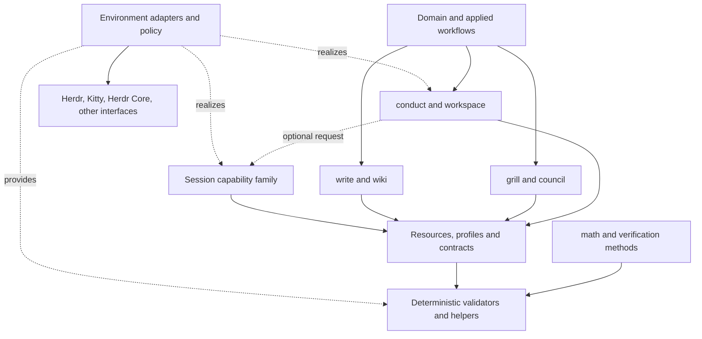
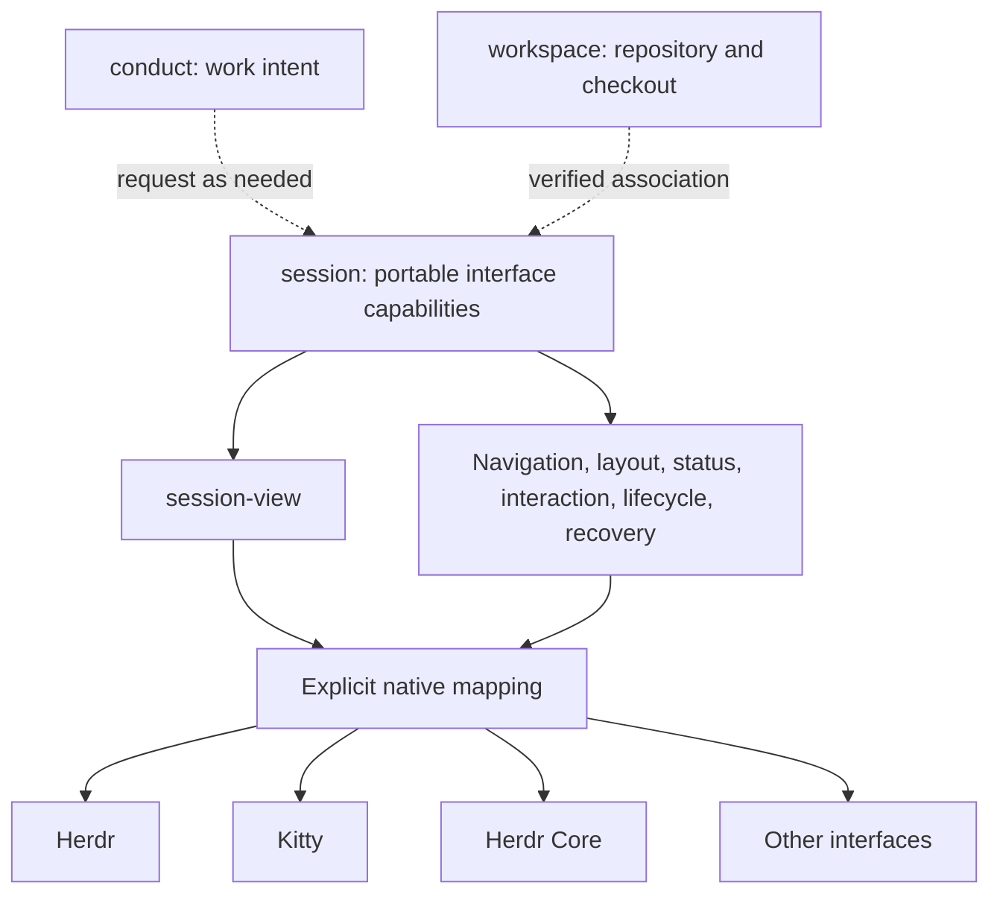

# Portable skill capability architecture

The owner accepted the direction in [AS-ADR-0003](../records/decisions/0003-portable-skill-capabilities.md). This page specifies the **proposed target**, not an installed runtime or shipped skill registry. See [current skill sources](skill-sources.md), [guest installation](guest-install.md), and the [implementation plan](../records/2026-11-24-skill-system-planning.md).

## Capability boundaries

This is a logical capability map, not an installer, mandatory import chain or new coordination engine. Prefer compact routers, progressive disclosure and independent activation only when useful. No circular required skill loads or implicit backend assumptions.

| Family | Responsibility | Boundary |
| --- | --- | --- |
| `conduct` | Decompose, plan, delegate, coordinate, integrate, supervise, recover work | No concrete session backend commands or host publication |
| `workspace` | Repository, checkout, worktree, workbranch, ownership, maintenance, handoff | No required Herdr binding |
| Session family | Multiple interface, view, navigation, layout, observation, interaction and lifecycle capabilities | Distinct from Git identity and inference context |
| `grill` | Structured questioning and resolving the answerable frontier | Reusable independently of Council |
| `council` | Review, remediation, independent perspectives, deliberation and delegated decisions | Evidence and authority limits, not consensus as permission |
| `write` | Generic drafting, editing, transformation, technical/structured prose | No assumed wiki topology |
| `wiki` | Knowledge governance, state, provenance, records, selected structural profiles | Local authoritative rules; optional tool integrations |
| Math/verification | Deterministic calculation, precision, units, uncertainty, evidence checks | No speculative calculation runtime; verification may be shared method |
| Domain/applied | Design-system, frugal, triage and project-owned site-system | Preserve existing ownership and stable module IDs |

## Session capability family — revised D9

The owner prefers **`session-view` over `session-window`** and wants multiple session capabilities. Organize the family by capability rather than the tool used to realize it. The following is a proposed starting taxonomy for the specification; it is not a final shipped registry or mandate to create every row as an independent skill.

| Candidate | Responsibility |
| --- | --- |
| `session` | Common concepts, session identities, selection, capability discovery and shared guardrails |
| `session-interface` | Understand interface surfaces, backend capabilities, available operations, context and interaction boundaries |
| `session-view` | Discover, identify, open, arrange or close logical views through the supported native mapping; distinguish views from sessions and processes |
| `session-layout` | Compose and restore arrangements, splits, groups and spatial relationships when supported |
| `session-navigate` | Select, switch, focus and traverse sessions/views using verified identities |
| `session-status` | Read-only observations, freshness, activity and capability availability; no inferred agent state |
| `session-interact` | Bounded input/output interaction and observation with explicit target and readiness checks |
| `session-lifecycle` | Create, attach, detach, suspend/resume or end sessions where the backend supports those operations |
| `session-recover` | Reconcile interrupted or stale associations, reconstruct state and safely resume |

Investigate whether layout, navigation, status, interaction and recovery are independently discoverable leaves or modes of a smaller family. **A view is not necessarily a window.** It can be a terminal pane, tab, window, split, document/editor surface or other supported interface projection. Preserve native relationships; some views host processes, others do not. Session identity, view identity, process identity, agent/inference context and workspace identity are separate, even when a backend associates them.

For every operation define intent, input/target identity, required capability, authority, preconditions, freshness, output, failure behavior and recovery. Compare actual versioned capabilities as native, safely composed, unavailable or unverified. Do not force equivalent semantics across incompatible systems or guess unsupported mutations. Missing backend support must yield an allowed alternative or explicit limitation. Start read-only; test isolated open/create/focus before lifecycle mutation and destructive maintenance. Never infer agent ownership from a visible pane or name alone.

**Preferred implementation references (owner refinement, 2026-11-24):** use [Kitty native sessions](https://sw.kovidgoyal.net/kitty/sessions/), [Kitty remote control](https://sw.kovidgoyal.net/kitty/remote-control/) and [Herdr Core](https://herdr.dev/core/) in place of tmux and Zellij in the forward-looking session capability comparison. Retain the existing Herdr TUI as the current Workbench integration. Kitty informs terminal-native views, layouts, navigation and interface control; Herdr Core informs independently owned PTYs, session lifecycle, client attachment and programmable control. These are complementary implementation layers, not interchangeable substitutes. Do not infer process persistence from a restored Kitty layout or identical API/authority semantics across clients. Compare actual supported versions, feature discovery, identity, lifecycle, control permissions and failure/recovery behavior. Existing tmux support and historical research remain intact until a separate reviewed runtime migration. Neither Kitty nor Herdr Core is an approved new dependency or installation by this choice.

Generic mappings may be separate portable resources where useful. Workstation retains its concrete Herdr runtime, environment/version checks, socket, agent ownership, permission and host/guest controls. No concrete backend commands belong in general conduct. No standalone tool-named namespace is required by D9. Keep existing working paths until compatibility evidence supports migration.

## Reasoning and delegated authority

Preserve `council-review` and `council-remediate` as independently invocable roles. Propose `council-decide` if independent activation proves useful; debate, plan, research, synthesis and Council grilling begin as compositions/modes. `grill` remains independently usable.

Distinguish applying accepted rules, deciding routine scoped details, choosing reversible/delegated options within budget, deliberating material choices within explicit delegation, recommending material choices outside scope and reserved owner/environment actions. Keep scope, authority and escalation conditions explicit. Use small receipts recording question, evidence, alternatives, decision, rationale, dissent/uncertainty, conditions and reconsideration. Record context independence separately from model/provider diversity, including unknown identities; simulated personas are not independent reviews. Full Council is not necessary for routine decisions.

## Knowledge, resources and deterministic tools

Portable `write` owns prose methods; `wiki` owns structural and knowledge semantics. Reconcile the Writing System drafts, wiki-nest accepted adaptation, uWiki Build/product authority, implementation behavior and local wiki rules before changing structural semantics. A selected public profile cannot override authoritative local contracts or environment restrictions. uWiki and wiki-reader are optional integrations, not normative wiki authority.

Explore canonical authoring resources (contracts, schemas, templates, profiles, examples) versus self-contained installed skill folders. Prove one resource shared by two real consumers; validate content/revision, missing-resource behavior and copy-folder installation. Do not assume repository-relative paths survive U16. Avoid symlink escape, network retrieval, extra installer or duplicated drifting templates. Use Markdown for methods, human-editable profiles and small machine receipts as appropriate. System/security and environment policy outrank accepted project rules, selected profile, public defaults and generic methods. No private preferences in public assets.

AG1.1 preserves current validator invocation, semantics and regressions before replacement. AG1.2 adds only adopted schema/resource/receipt/dependency checks. No script executor, installer, network crawler or hook manager in the validator. Hooks require separately reviewed environment adapters; portable methods may describe lifecycle intent, not confer permissions.

## Migration and adoption

Inventory all existing skill references, credits, registry names, roles, hooks, consumer calls, validation and packaging. Specify source/consumer mapping, including legacy names and anchors, before removing old behavior. Keep fallback and supported behavior until the new path is proven. Compare old/new validators on the same corpus, prove isolated installation and harness loading, verify absent backends and unsafe targets refuse safely, and retain exact candidate receipts. Update live pins only via authorized Workstation operations. Roll back to a known compatible source/consumer/pin pair; never silently remove the only functioning path or force a shared runtime migration. Preserve historical records and separate source merge, pin, install, live adoption and owner acceptance.
