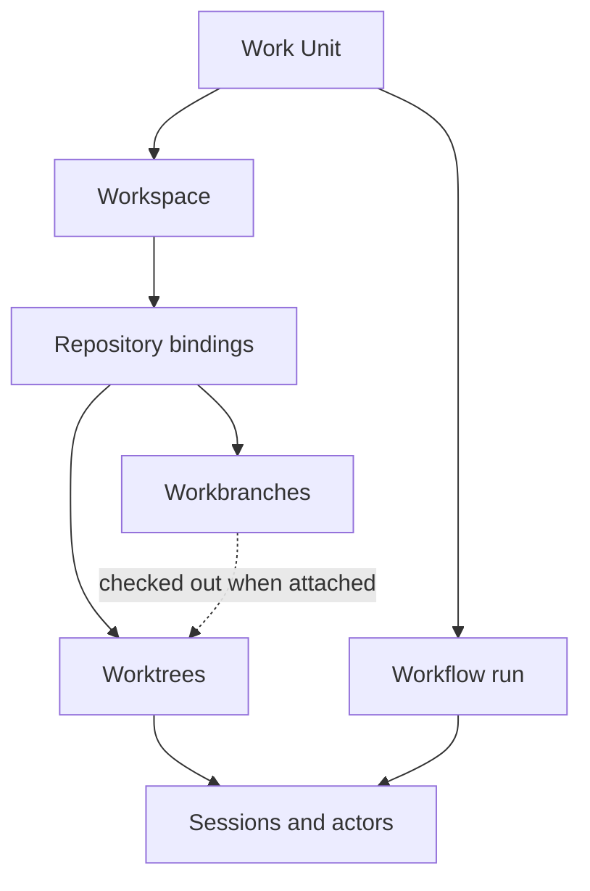

# Common workspace coordination and workflow API

**Proposal, not an implemented CLI or an accepted schema.** The owner requested a Workstation-lens review of agents #13 and common coordination and workflow ideas on 2026-11-16. This page proposes a shared semantic API: the same inputs, results and refusal meanings across skills, native commands and eventual UI consumers. The first implementation stays small: workspace skills calling the observed Herdr 0.9.5 commands. No daemon, central ledger, generic adapter framework or new `ws` mutation commands are needed.

**Partial implementation (2026-11-18):** `workspace-handoff` implements the handoff/resume note contract (portable fields, recipient revalidation, changed-SHA invalidation) as skill guidance and templates. It does not add a machine API, ledger or orchestration framework.

**Related proposal (2026-11-20):** standing Control / Record / Audit tab roles and profile layers are proposed in [control-record-audit.md](control-record-audit.md). That design does not change Herdr operation contracts here; Workbench layout templates remain Workstation-owned.

The one-clone-per-namespace arrangement and two sidebar levels remain the current Workbench convention. They are one binding of this model, not universal constraints on every public workspace.

## Vocabulary and authority

| Concept | Meaning | Authority and identity |
| --- | --- | --- |
| Workspace | Logical working context that can include one or more repositories, worktrees, resources and services | Its existing owning descriptor or source; keep current names and aliases |
| Repository | Git history and shared administrative state; separate clones of one remote remain distinct local repositories | Git; local common Git directory identifies shared state, not portable global identity |
| Worktree | A checkout with its own HEAD and index, sharing repository objects and most refs | Git registration and observed checkout path; main and linked worktrees are both checkouts |
| Workbranch | Proposed coordination term for a topic branch's purpose and intended integration target | Git owns the ref and tip; the work owner records intent, base and dependencies only when needed |
| Work Unit | Bounded intended work with constraints and acceptance criteria | Its natural issue, brief or other work authority; can span several branches and repositories |
| Workflow and run | Reusable process, and one execution of that process | The selected workflow owner; a run may have multiple actors, sessions and attempts |
| Actor, role and session | Worker identity, responsibility in this work, and a runtime attachment | Runtime/provider observations; harness and model are attributes, not permission identities |
| Herdr workspace | Provider-specific workspace/sidebar item and its pane attachments | Herdr's returned ID and checkout metadata; label alone is not identity |

A workbranch is not a new Git object or a required one-to-one link to an issue, worktree, PR or agent. A branch can be temporarily un-checked-out; a worktree can have detached HEAD. An absent upstream, unavailable provider or ambiguous association is reported explicitly, never invented.

Resolve existing workspace identity to repository bindings, then native refs, checkout paths and provider IDs. Keep machine paths local. Do not prescribe a new global ID syntax, derive identity from a label, or expose private paths in public records. Portable hand-offs use repository/workspace locators and refs; the recipient resolves its own paths and refreshes provider IDs.

## Relationships

A branch dependency, a checkout's creation base, a filesystem path and a sidebar parent are four different relationships. Record an explicit dependency/base ref and observed base commit when work branches from another topic. Git worktrees share repository state; creating one from another does not create an isolation boundary or a Git parent-child worktree hierarchy. Two UI levels do not imply nested filesystem directories or cascade deletion.

## Responsibility split

| Owner | Responsibility |
| --- | --- |
| `agents` / `workspace-*` | Common vocabulary, operation preconditions, continuity reports and reusable workflows; concrete Herdr command instructions initially |
| `orchestration` (M3, later) | Reusable coordination of agents, tasks, workflows, handoffs, and execution systems; Herdr is one supported environment, not the namespace definition |
| Git | Refs, commits, checkout/index state, registration and conflicts |
| Herdr | Workspace/pane/session topology and native lifecycle operations |
| Workbench in Workstation | Guest policy, approved paths, sandbox refusals, commit/integration helpers, promotion and host hand-offs |
| Workstation `ws` | Resolve and observe; derive disposable views, without becoming the owner of Git, PR or session state |
| Project skills | Project checks, branch conventions and acceptance requirements; may narrow the common method |
| Workflow Factory or another future workflow runtime | Process transitions, if adopted; remains independent WIP |
| Owner and native authorization | Permissions, approvals, acceptance and publication |

A shared method never grants access. In ordinary Workbench sessions, socket operations remain owner-run until their gate is installed and admitted. The recorded Cursor bootstrap is an explicit session exception with per-command approval, not a public module default. Neither plan approval nor starting a workflow approves future destructive actions.

## Operation contract

The following names are **design identifiers**, not shell commands, Herdr subcommands, MCP tools or promised `ws` endpoints. Skills should describe these contracts in ordinary language and map them to version-checked native commands. Do not fabricate an executable API.

| Operation | Inputs and preconditions | Result and refusal behaviour |
| --- | --- | --- |
| `workspace.inspect` | Existing locator plus environment; read native Git and Herdr state | Resolved bindings with source/time; unavailable and ambiguous stay explicit |
| `workspace.open` | Exact existing checkout; inspect current attachments first | Reuse matching attachment or create one when authorized; duplicate labels never select the target |
| `workbranch.prepare` | Repository, topic ref, explicit base ref and observed base tip, integration target and work intent | Existing compatible branch or approved new branch; divergent existing branch is a conflict, never reset |
| `worktree.prepare` | Repository, branch or explicit detached commit, verified destination and requested UI group | Observed checkout and attachment; existing occupied branch/path or unsupported grouping refuses |
| `coordination.claim` / `release` | Work scope, actor/session, affected repo/branch/path and expected heads | Advisory assignment and integrator responsibility; no enforced lock claim without an actual mechanism |
| `workspace.status` | Workspace set and inspection scope | Per-provider observations, conflicts and partial coverage; no inferred clean/idle status from missing data |
| `workflow.handoff` / `resume` | Intent, exact candidate refs/tips, constraints, checks, unresolved work, receiving workspace and requested next action | Resumable note; recipient revalidates refs, policies and attachment before continuing |
| `workbranch.integrate` | Named integrator, topic/base tips, target, checks and current authorization | Native integration with actual resulting tip or conflict; serialize shared target writes |
| `workspace.maintain` | Report of candidates, retention evidence and explicit action scope | Preview first; recheck active sessions, dirty files, refs and preservation before each action |
| `worktree.retire` | Exact registered checkout/provider ID, no active users, clean state and preserved work | Remove only the approved checkout; branch deletion is separate and never implied |

Status joins observations rather than copying Git or GitHub into a second status database. Treat a missing executable as unavailable, a complete successful query with no match as absent, and a denied/malformed/failed query as an error with a reason. Include partial results when only one provider succeeds.

For a future machine interface, use Workstation's proposed CLI contract: results on stdout, diagnostics on stderr, versioned structured output and stable errors. A minimal request/result sketch is:

| Side | Proposed fields |
| --- | --- |
| Request | `schema_version`, `operation`, `target`, `parameters`, `expected` (refs/tips/attachment), `request_id` when retry correlation is needed |
| Result | `schema_version`, `operation`, `outcome`, `observations`, `changes`, `errors`, `partial`, `next_action` |
| Observation | `source`, `observed_at`, `state`, `value` or bounded reason; use Unix milliseconds where Workstation requires them |
| Error | Stable code, affected target, safe explanation and recovery action |

Suggested error meanings are stale precondition, ambiguous target, dirty checkout, active session, branch occupied, policy denied, provider unavailable, unsupported capability and partial failure. These are proposals; spelling, JSON shape and exit mapping must be settled with a concrete consumer before a tool promises compatibility.

Inspect before retrying an interrupted mutation. If creation succeeded but attachment failed, report the surviving branch/worktree and reopen/adopt it only when authorized; never delete it merely to make a retry convenient. A request ID is correlation, not proof of idempotence. Do not suppress failure as success because the expected label already exists.

## Coordination rules

1. **One writer per checkout.** Assign each editing session its own checkout. Sharing context or a remote URL does not authorize edits in someone else's checkout.
2. **One integrator per target.** Serialize `develop` and other shared ref writes across linked worktrees. Git's native lock files protect individual operations, not an entire workflow. A note or claim is advisory, especially under a shared Unix account.
3. **Revalidate before mutation.** Resolve current paths, refs and IDs immediately before acting. Expected-head checks only protect races to the extent the actual native operation enforces them; a preflight read alone is not atomic.
4. **Keep review separate.** Candidate identity and checked revision travel with the hand-off. An agent finishing or a harness turn ending does not mean verified, reviewed, accepted or published.
5. **Preserve competing work.** No automatic stash, reset, force removal, rebase of another actor's branch, lock-file deletion, trust-dialog answer or session termination as conflict recovery.
6. **Retire deliberately.** Inspect tracked, untracked and ignored local data, active panes/processes and retained tips before removal. An unavailable session query leaves activity unverified and blocks unattended removal. Closing a sidebar group does not approve removing descendants.
7. **Handle squash merges.** A clean checkout or branch name is insufficient evidence of safe deletion. Ancestry checks may fail after squash integration; retain a recovery ref or owner-approved preservation evidence and use the owning publication/realignment procedure.
8. **Coordinate across repositories by hand-off.** Track dependencies and resulting revisions separately. There is no atomic cross-repository transaction: if one change lands and another fails, retain both states and report the next recovery action.

In Workbench, `develop` is guest-local integration, and `main` remains the owner-published baseline. Workbranch preparation must not turn promotion into a direct feature-to-main workflow. Promotion, checks on the exact promoted candidate, landing and guarded realignment belong to the installed Workbench workflow; documentation of FW steps alone does not enable them.

## Skill ideas and build order

Keep `workspace` as the namespace. Start with the already proposed skills; extra names below are candidates, not approved modules or new namespaces.

| Skill or mode | Common workflow | First useful evidence |
| --- | --- | --- |
| `workspace` | Orient: resolve work intent, repositories, bindings and restrictions | One clone and linked worktree mapped without treating labels as identity |
| `workspace-open` | Inspect, reuse or attach the requested context | Duplicate label and already-open checkout |
| `workspace-worktree` | Prepare, adopt and retire checkouts | Occupied branch, dirty checkout, failed attachment, surviving work |
| `workspace-status` | Reconcile Git and Herdr observations | Herdr denied/unavailable alongside successful Git query |
| `workspace-maintain` | Report drift and cleanup candidates, apply approved actions | Active session, stale head and squash-merged topic preservation |
| `workspace-handoff` (built 2026-11-18) | Hand off and resume work across sessions/repositories | Receiving session detects changed candidate tip |
| `workspace-workbranch` (later) | Base/target selection, dependent topics and integration hand-off | Two topic branches and one serialized integrator |
| `workspace-coordinate` (later) | Allocate checkout writers, responsibilities and dependencies | Two sessions avoid one checkout and shared target races |
| `workspace-workflow` (later, only if needed) | Compose prepare, implement, verify, review, integrate and retire | Interrupted run resumes without duplicate mutation |

The latter workflows may fit modes or references of existing skills; split them only when independent invocation needs justify it. The common vocabulary does not require an orchestrator, headless agents or a live coordination service. Generic integration concepts may be documented now; actual Workbench integration instructions wait for the relevant admitted FW step.

First prove the read-only mapping and one disposable lifecycle with the installed Herdr pin. Capture a narrow reusable report and one hand-off. Then extract M3 coordination guidance from observed duplication. Defer schema tooling and additional backend implementations until a consumer needs them. First pin and cell S1 remain Workstation decisions; this proposal does not advance those gates.

## Acceptance examples for the guest implementation

These are future behaviour checks, not results from this documentation review:

- Opening an already attached checkout reuses it; a duplicate label never attaches the wrong repository.
- Two sessions requesting one branch do not force it into two checkouts or reset its ref.
- A topic based on another topic records both the dependency and actual base commit, independently of sidebar nesting.
- An interrupted create returns the surviving checkout; retry inspects and adopts rather than recreates.
- A stale check or changed candidate tip invalidates an integration/cleanup plan.
- A dirty or active checkout survives maintenance; a denied provider query does not become idle.
- A multi-repository hand-off resolves paths locally, preserves exact revisions and reports partial completion.
- The public method works under Workbench's ordinary owner-run socket policy as well as the explicitly approved bootstrap.

## Sources and limits

Read on 2026-11-16; Workstation is private for now. The design inference here is the proposed operation contract, not a claim that these operations exist.

| Source | Basis |
| --- | --- |
| [Workstation work model](https://github.com/luckgrid/workstation/blob/99da1da21ece13965d0f0cb765347695782ac6db/wiki/architecture/work-model.md) and [execution and continuity](https://github.com/luckgrid/workstation/blob/99da1da21ece13965d0f0cb765347695782ac6db/wiki/architecture/execution-and-continuity.md) | Intent and Work Units are independent of branch/session placement; workspaces may span repositories |
| [Authority map](https://github.com/luckgrid/workstation/blob/99da1da21ece13965d0f0cb765347695782ac6db/wiki/architecture/authority-map.md), [contracts](https://github.com/luckgrid/workstation/blob/99da1da21ece13965d0f0cb765347695782ac6db/wiki/architecture/contracts.md) and [CLI](https://github.com/luckgrid/workstation/blob/99da1da21ece13965d0f0cb765347695782ac6db/wiki/architecture/cli-and-machine-interface.md) | Native authorities, exact checkout attachment, bounded observations and proposed machine interface |
| [WS-ADR-0007](https://github.com/luckgrid/workstation/blob/99da1da21ece13965d0f0cb765347695782ac6db/wiki/records/decisions/0007-minimal-core-first.md) and [fast-workflow record](https://github.com/luckgrid/workstation/blob/99da1da21ece13965d0f0cb765347695782ac6db/wiki/records/2026-11-15-fast-workflow-vm-direction.md) | Guest-local integration, one integrator, installed gates and owner publication |
| [Current workbench-herdr](https://github.com/luckgrid/workstation/blob/99da1da21ece13965d0f0cb765347695782ac6db/packages/workbench/guest/skills/workbench-herdr/SKILL.md) | Existing commands and ordinary socket policy; not live-tested in this review |
| [Git worktree](https://git-scm.com/docs/git-worktree) and [Git branch](https://git-scm.com/docs/git-branch) documentation | Shared/per-worktree state, branch occupancy, removal and safe branch deletion semantics |
| [Module composition](skill-sources.md) and [seventh round](../records/2026-11-16-workspace-skills/README.md) | Namespace ownership, narrowing tiers and bootstrap scope |

No guest access, Herdr survey, installation, sandbox change or runtime API implementation occurred in this review.
