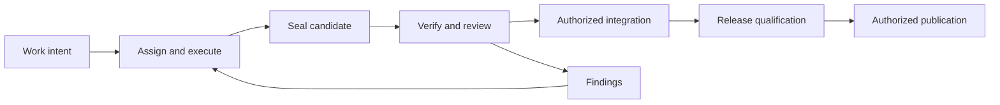

# Portable agent coordination and autonomous delivery contracts

Research record, not an installed module, accepted interface, permission, schema or revision of the current program. The owner's November 24 direction is to prioritize methodical autonomous development during Workstation refactoring: agents integrate bounded reviewed work without a PR for every increment, a separate qualification line prepares future versions, and human developers direct and accept releases while remaining free to participate in implementation. This page records the portable implications without defining any particular environment's branch, storage or publication authority.

## Evidence and lineage

- [Agents #18–24](https://github.com/luckgrid/agents/pull/24): PR #24 was observed merged on November 24. Integrated head `30698403b8dda6bed440e3bdca93c8e828b6675e` became main commit `cf86b6ad3298c4468d1a11c07c3613670f991740`. Validator, orchestration, wiki and handoff changes were combined. Prior independent review reported 28/32 files identical to reviewed components; this research did not reproduce those checks. No install, pin change or file-exchange admission follows from merge.
- [Agents #23](https://github.com/luckgrid/agents/pull/23) and [#25](https://github.com/luckgrid/agents/pull/25): observed open, respectively at `8c026df5d6372210488b75738b840d0a8f436ea9` and `7d8e319ed8e72e92a20e57601369502ef61d919f`. The Grill candidate includes shared documentation ancestry. This motivates separating durable semantics from repeatedly reconciled operational state, not modifying either draft. Council's earlier landing via #17 should not be attributed to #24.
- The merged [orchestration skill](https://github.com/luckgrid/agents/blob/cf86b6ad3298c4468d1a11c07c3613670f991740/skills/orchestration/SKILL.md) already requires separate checkouts, one integrator, native dispatch/status, durable handoffs and environment-specific authority. Keep that foundation. The earlier workspace-owned integration proposal in #23 reduces duplicate PRs; the proposed next step removes PRs as a requirement for internal delivery.
- Owner-directed session research favors portable capability archetypes over terminal-product namespaces, with Kitty and Herdr Core as references; session-interface, view, layout, navigate, status, interact, lifecycle and recover are candidate concepts, not newly installed modes. Lifecycle-hook research considers harness-independent adapters, with environment-owned event meaning and authorization. The native Rust validator and conduct/session work remain distinct in-flight efforts.
- [WfOS](https://github.com/luckgrid/wfos) defines a coordination environment over native providers, not a replacement for them. The companion [Workstation research](https://github.com/luckgrid/workstation/pull/105) and [Workflow Factory research](https://github.com/luckgrid/lg-workstreams/pull/233) have complementary scope (access may be restricted). Do not import provider-specific implementation contracts into this portable skill package.

## Portable model

| Concept | Contract direction |
| --- | --- |
| Work Unit | Stable intended outcome, constraints and acceptance conditions; independent of PR or session |
| Execution | Run and attempt identities, scope, responsible actor, environment and native provider locator |
| Candidate | Immutable source or artifact identity and base/dependencies |
| Verification | Test definition, environment, result, evidence reference and issuer |
| Review | Scope, candidate, independent reviewer, findings and dispositions |
| Delivery | Correlation of integrated increments with outcome and evidence |
| Release | Qualified scope and authorized acceptance; optional external publication |

A skill guides reasoning and use of capabilities. A native tool performs deterministic operations. An adapter translates a provider-specific operation to a capability contract. An environment validates policy and owns execution authority. A workflow composes transitions and evidence. Do not define all five as skills, nor make a skill an authorization system.

## Candidate lifecycle

The operator chooses independent or coupled delivery according to actual dependency and acceptance scope. Component worktrees need not publish independently. A new integration identity requires combined checks and review appropriate to risk. The portable method must work when an environment has no PR provider, or when review is exchanged through a local candidate, signed manifest or verified bundle. External publication remains optional until policy requires it.

Keep findings durable across agent restarts and harness changes. Reuse prior review evidence only with explicit scope/impact analysis; changed source, test policy, dependencies or integration-only edits can invalidate it. Separate source qualification, integration, publication, installation and live operation. A review PASS is not an authorization token.

## Lifecycle hooks and session capabilities

Hooks are event sources, not truth merely because invoked. Distinguish a native session start, agent turn ending, request completion, check completion, reviewed outcome and accepted integration. A hook must report its provider and native event, stable correlation, observed time, deduplication key and evidence/unknown status. The receiving environment validates transition authority and handles retry/reconciliation. Never send a foreign pane an unsolicited instruction or auto-approve a trust/permission dialog.

A portable session reference may have provider, external session ID, node/environment identity, role, work/run association, and availability state. Provider sessions can be incomplete, offline or unexportable. Preserve native ownership and selected handoffs, not a mandatory universal transcript format. The [OpenTelemetry GenAI instrumentation discussion](https://opentelemetry.io/blog/2026/agent-harness-genai-instrumentation/) illustrates common trace/span vocabulary; conventions continue to evolve and are not internal schema mandates. [W3C PROV](https://www.w3.org/TR/prov-dm/) provides a useful entity/activity/agent mapping. Neither establishes an agent's authorization or correctness.

## Context, knowledge and conduct

A deterministic context query should resolve the current specification, relevant decisions, work identity, allowed scope, exact source, dependencies, open findings, evidence and applicable policy, with freshness and missing-source markers. The agent reasons over the result rather than reconstructing state from several chats. Preserve original research or approved evidence in its natural authority. Never publish private session data or treat imported content as instructions. Maintain the current wiki skill contract until the separate Writing System/wiki-nest/µWiki authority audit resolves the P8 semantics. No new generic wiki status or repair rule is proposed here.

Use [Conventional Commits](https://www.conventionalcommits.org/en/v1.0.0/) and native [Git trailers](https://git-scm.com/docs/git-interpret-trailers) as candidate conventions for authored reason plus tool-derived public-safe correlation. A worker should not guess actor identity, run ID or policy. Prefer structured outputs, deterministic validation, and explicit unknown/refused results. Preserve source history after qualification.

## Proposed proof before skill changes

1. Recover a work item's candidate and outstanding findings after switching harnesses without reading full transcripts.
2. Compare a PR-backed and PR-independent delivery: same review/evidence semantics, different publication binding.
3. Replay a duplicate hook event without duplicating a completion; distinguish turn-end from verified outcome.
4. Deny an unsupported capability, stale checkout, unapproved export or unauthorized installation; retain an explicit reason.
5. Have a different worker reconstruct a bounded handoff and revalidate current source and policy.
6. Measure context footprint and manual steps against the existing method; do not require a new runtime, database or harness.

No new skill namespace or module should be created simply to represent this research. Adopt only demonstrated contracts in the existing orchestration, workspace, handoff, wiki and Council families as appropriate, after their current proposed changes are reviewed. Keep implementation details in the owning environment. GitHub metadata and selected source documents were read; guest checks, hook behavior, installed capabilities and live state were not inspected here.
