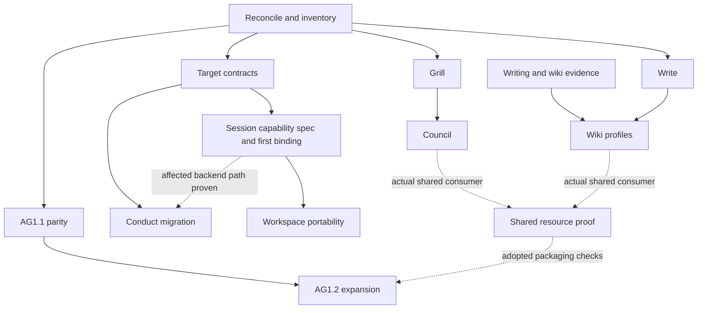

# Skill-system research assessment and implementation planning

## Intent

Assess the supplied deep research report as planner, preserve its findings and limitations, record the owner's dispositions and refine an independently reviewable implementation program. The [research brief](2026-11-24-skill-system-research-brief.md) is the original assignment history. The supplied `agent-skills-deep-research-report.md` is research evidence rather than an accepted specification. Its conversation-local citation markers are not durable external source links; record actual source paths and pins rather than inventing a public copy.

## What was checked

The report identified eleven skills in four namespaces at #24 main `cf86b6ad3298c4468d1a11c07c3613670f991740`; it audited every top-level router, recommended retain/enhance for council-review and workspace-handoff, retain council-remediate, refactor council/wiki/status/maintain, rename orchestration, split workspace/worktree and move or replace backend-bound workspace-open. It compared ecosystem standards, proposed conduct, layered architecture, Council expansion, wiki profiles, resource/tool contracts, evaluation and nine work packages.

Planner verdict: **useful architecture input, incomplete research assignment**. The researcher disclosed missing associated references, credits, validator fixtures/self-tests, private writing/wiki corpus, and independent research model. No repository writes or execution occurred in that research session. External catalog entries often lack exact revisions/licenses and file-level locators. Preserve the report's source/installation distinction. Its numerical scoring formula allows maximum 60 and minimum −25 (dimensions 0–5), not its stated denominator 55, and lacks dimension-level values; use qualitative priorities until reproducible scoring exists.

The planner authenticated to previously inaccessible source repositories and inspected initial contracts and READMEs. Access is resolved, not the comprehensive reconciliation. Verified Agents main is still the #24 source baseline. Current STATE is stale; correct it in P0 with operator coordination rather than invent current guest installation facts.

## Decisions

Owner accepted D1–D8 and D10 and revised D9. The owner specifically chose capability archetypes for session interfaces and related functions, then refined the naming: **session-view, not session-window, and multiple session capabilities**. The complete dispositions are in [AS-ADR-0003](decisions/0003-portable-skill-capabilities.md). The proposed [target architecture](../architecture/skill-capability-evolution.md) specifies the session family, conduct/workspace separation, Council and grill, writing/wiki and deterministic resources. The view-based family is deliberately more general than a terminal window model. Exact additional skill names and modes are candidate design choices, not a settled shipped registry. Herdr, Kitty and Herdr Core are implementation references, not taxonomy.

Use accepted direction to plan bounded work. Do not turn the incomplete survey into a universal rewrite freeze. Restrict evidence blockers to their affected packages. Establish grilling before collective questioning, writing before or alongside its wiki consumers, validator parity before expansion, and prove shared resources in real installed folders. Preserve M10 completion and historical IDs; portability is a follow-up. Independent context and model/provider diversity are distinct. Delegated decisions remain bounded; material out-of-scope choices and protected operations escalate.

## Evidence completion

Read all current associated files, fixtures, credits, validators, registry entries, actual invocations and consumers before affected edits. Pin selected upstream references/licenses, inspect real implementations and record inaccessible evidence. Independent review should challenge each scoped design and migration. Authenticated planner source discovery:

| Repository and revision | Initial observation |
| --- | --- |
| [lg-workstreams](https://github.com/luckgrid/lg-workstreams/tree/c1c9ef09c56cbbda2ed2ca381561c082dd27a49e) | [Wiki structure contract v0.4](https://github.com/luckgrid/lg-workstreams/blob/c1c9ef09c56cbbda2ed2ca381561c082dd27a49e/Plan/bin/systems/writing-system/contracts/wiki-structure-contract.md), draft; [filename contract v0.2](https://github.com/luckgrid/lg-workstreams/blob/c1c9ef09c56cbbda2ed2ca381561c082dd27a49e/Plan/bin/systems/writing-system/contracts/lg_workstreams_document_filename_contract.md), draft |
| [wiki-nest](https://github.com/luckgrid/wiki-nest/tree/45624eb12a2049850228cc4579d7d2f75e7a5d69) | [Accepted wiki structure](https://github.com/luckgrid/wiki-nest/blob/45624eb12a2049850228cc4579d7d2f75e7a5d69/wiki-structure.md) treats the earlier pinned Workstreams contracts as lineage rather than overriding local authority |
| [uWiki](https://github.com/luckgrid/uwiki/tree/4698d15e51350b176417d39ce3f402b8e3529a82) | [README](https://github.com/luckgrid/uwiki/blob/4698d15e51350b176417d39ce3f402b8e3529a82/README.md) describes scan, validate, overview, matrix, graph, select, session, compare and Build planning authority |
| [wiki-reader](https://github.com/luckgrid/wiki-reader/tree/ebbd0214d37cd29f3e53217d1e3cf39e6fd025fb) | [README](https://github.com/luckgrid/wiki-reader/blob/ebbd0214d37cd29f3e53217d1e3cf39e6fd025fb/README.md) documents reading/navigation, not structural authority |

Some sources are private; public documentation must not reproduce private payloads. Inspect the full Writing System contracts, templates, foundations, uWiki Build planning, implementation/tests, wiki-nest conventions, wiki-reader actual behavior and Agents/Workstation local rules. Map normative, draft, historical, implementation-specific and contradictory evidence. **Blocks wiki structural semantics, not unrelated development.**

## Refined work packages

P-IDs here are planning identifiers, not replacements for M/AG roadmap IDs or existing task IDs elsewhere. Operator checks actual queue, branch and worktree status before assigning, serializes shared wiki/registry/validator writers, and picks publication boundaries by acceptance unit. Scope each package with exact source/evidence, implementation, regression tests, independent review and rollback. All are planned until separately qualified.

| Package | Priority | Hard prerequisite | Scope and acceptance proof |
| --- | --- | --- | --- |
| P0 — closeout | Immediate | Verified source and operator coordination | Reconcile STATE/README after #17/#24; issue #12 regression and authorized closure handoff; review #23; confirm current pin separately. |
| P1 — associated-file audit | Immediate | Source access | Read all eleven skills plus associated files, fixtures, dependencies and selected upstream sources. Inventory every behavior and consumer with disposition. |
| P2 — target contracts | High | Relevant P1, accepted ADR | Specify boundaries, target vs shipped registry, portable contracts, compatible consumer and migration paths; independent architecture review. |
| P3 — AG1.1 parity | High, parallel | P1 validator corpus, M2 merged | Rust validator preserves current CLI/exit behavior and all regressions; compare old/new on shared positive and negative corpus; deterministic diagnostics, ordinary validation offline. Retain old until parity and cutover accepted. |
| P4 — conduct | High | P2, affected P1, P5a proof where removing backend behavior | Map old modes, define portable coordination, no concrete backend commands in general method; preserve invocation/reference compatibility, registry and rollback. |
| P5a — session capability family | High | P2 and scoped P1 | Specify `session-view` and multiple interface/layout/navigation/status/interaction/lifecycle/recovery capabilities; decide minimal modes/leaves and exact native mappings; prioritize Kitty native sessions/remote control and Herdr Core PTY/session APIs alongside current Herdr; compare interface versus persistence semantics; verify read-only status first, then isolated non-destructive operations. |
| P5b — workspace portability | High | P5a equivalent binding for affected operations | Refactor mandatory Herdr dependency; migrate open/create/focus, then guarded maintenance/cleanup. Preserve identity, dirty/active-worktree refusal, provider absence, stale state and consumer compatibility. |
| P6 — M5 grill | High, parallel | Settled questioning contract and relevant P1 | Independent answerable frontier, evidence/code/doc checks, recommended choices, delegated routine decision limits, conversational fallback and fixtures; use current wiki rules. |
| P7 — Council phase two | High | P6, D4, relevant audit | Retain review/remediate; add deliberation, decision and synthesis; test simulated vs separate context, model/provider identity, dissent, bounded authority, malformed receipts, refusal/escalation. |
| P8 — writing/wiki evidence | High, parallel | Authenticated access | Full authority map, contradictions, source pins, profile options and actual fixture behavior. No wiki structural changes until evidence. |
| P9 — write | Medium-high | P1 writing duplication, concrete consumers | Compact reusable writing method and templates; demonstrate simplification of two real workflows. |
| P10 — wiki profiles | High | P8, relevant P9 contracts | Portable knowledge method, explicit selectable structural profiles, authoritative overrides, filename/metadata/record/templates and fixtures; optional tooling only. |
| P11 — resource packaging proof | Medium-high | Concrete two-consumer use case | One canonical resource, deterministic self-contained copies or equivalent, content/revision parity, missing-resource and installed-folder tests, no private leak. |
| P12 — AG1.2 expansion | Medium-high | P3, adopted resource/receipt/dependency contracts | Add justified static checks and fixtures, machine diagnostics, read-only validator. |
| P13 — math/verify | Medium | Concrete use cases | Small deterministic-tool-first math, units/precision/uncertainty/fallback; shared verification first, independent namespace only on evidence. |
| P14 — remaining modules | Continuing | Module-specific gates | M6/M7 domain ownership, M8 optional tools, M9 triage, AG2 after validator stability, AG3 only with required Workstation security acceptance. |

## Delivery sequence and ownership

Suggested first assignments: Agents operator P0/P1 and AG1.1 parity planning; independent authenticated knowledge researcher P8; architecture/specification track P2/P5a/P6 contract. Workstation operator reviews actual session/Herdr bindings, affected roles/hooks and distribution compatibility, not duplicate portable skills. Controller coordinates only cross-workspace dependencies and material events. Use optional builders and one integration writer per actual delivery; no per-worktree draft proliferation or duplicate aggregate PR. Related cross-repo work can be separately accepted with compatibility staging; old pins remain usable until owner-authorized cutover.

Proofs: current/target skill inventory and dependencies, old/new validator comparison, missing capability and stale identity refusal, active checkout/agent preservation, read-only vs mutation separation, native view mapping across backend types (unsupported operations explicit), independent Council evidence and authority, self-contained resources, exact-head qualification and independent findings disposition, pin/installation receipt separate from source merge. Roll back to compatible source/consumer/pin pair via existing authorized procedures. No unreviewed hook/script installation, privileged actions, guest publication, file exchange, archive extraction or runtime admission.

The plan establishes priorities, not a new scheduler or automatic PR count. Concrete specifications, session names beyond the owner-selected view terminology, compatibility mechanisms and resource packaging remain proposed. The documentation candidates must be reviewed before landing. See companion [Workstation #102](https://github.com/luckgrid/workstation/pull/102).

## Further owner refinement — session implementation references (2026-11-24)

The owner prefers Kitty and Herdr Core over tmux/Zellij as the forward-looking session capability references, to investigate more native and lower-level composability. P5a should inspect the actual [Kitty session](https://sw.kovidgoyal.net/kitty/sessions/) and [remote-control](https://sw.kovidgoyal.net/kitty/remote-control/) contracts and [Herdr Core](https://herdr.dev/core/) API and terminal lifecycle at versioned revisions, using existing Workstation research as a starting point. Keep view/layout and PTY/process lifetime distinct; prove native operation support, authority, identity and failure semantics. Current Herdr remains the concrete Workbench binding; no tmux fallback removal or new backend installation follows from this planning preference.
